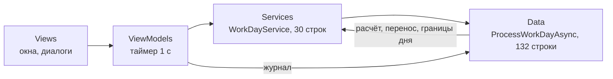

# Анализ WorkTimeRegister

Файл собирает разборы проекта по сессиям в порядке проведения. Каждая следующая сессия отвечает на предыдущие. Тексты сессий приведены без правок, изменён только уровень заголовков.

| Сессия | Кто | Дата | Что сделано |
| --- | --- | --- | --- |
| 1 | Claude (Opus 5.5) | 28 октября 2026 | Аудит чтением кода, без сборки и тестов |
| 2 | Codex | 28 октября 2026 | Сверка аудита с кодом, 69 тестов, 13 сценариев на временных базах |

Обе сессии проверяли версию 1.5.2, коммит `ef81e09`.

## Сессия 1: Claude, аудит кода

Версия 1.5.2, коммит `ef81e09`, 28 октября 2026. Аудит выполнил Claude Opus 5.5 чтением кода. Сборку и тесты аудитор не запускал.

### Итог

Серьёзных уязвимостей нет, ошибок, портящих базу, аудит не нашёл. Главный риск касается учёта: после падения программы и при опции «Продолжать рабочий день после полуночи» приложение засчитывает как работу часы, когда человек не работал. Архитектура выдержит рост данных, но рост функций даётся ей тяжело.

| Область | Оценка | Коротко |
| --- | --- | --- |
| Безопасность | Низкий риск | Сети нет, SQL с параметрами, импорт проверяется |
| Корректность учёта | 2 высоких риска | Простой и сон попадают в работу |
| Рост функций | Слабо | Логика дня в слое данных, 2 категории зашиты в схему |
| Процесс разработки | Слабо | Нет CI, анализаторов и единого стиля |

Находки: 4 с высоким риском, 5 со средним, 2 с низким.

| Показатель | Значение |
| --- | --- |
| Строк в `src` | 3400 |
| Строк тестов | 1739 |
| Тестов | 52 |
| Методов репозитория, которые рабочий код не вызывает | 10 из 13 |
| Коммитов в истории | 3 |

### Учёт времени

#### Т1. Падение программы засчитывает простой как работу (высокий)

При обычном выходе программа записывает закрытие дня, и время вне программы в итоги не входит. Если процесс падает, записи нет: день остаётся открытым, и период продолжается с момента до падения. Без опции «после полуночи» лишние часы копятся до 00:00, с опцией без ограничения.

Пример: работа с 09:00 до 18:00, программа закрыта с 14:00 до 15:00.

| Как закрыли программу в 14:00 | Работа за день |
| --- | --- |
| Обычный выход | 08:00:00 |
| Падение | 09:00:00 |

Где код может упасть:

- `ActionLogWindow.axaml.cs:35` и `:56` открывают файл экспорта и импорта вне `try`, внутри `async void`. Ошибка ввода-вывода (нет прав, файл занят) завершит процесс.
- `Uninstall.cmd` на Windows завершает процесс через `taskkill /F` (`packaging/windows/.../Program.cs:171`).

ТЗ, раздел 14, требует, чтобы ошибки не завершали приложение аварийно.

#### Т2. Опция «Продолжать рабочий день после полуночи» превращает сон ноутбука в работу (высокий)

При пробуждении цикл в `SqliteTimeEntryRepository.WorkDays.cs:19-33` проходит каждую пропущенную полночь: закрывает день и открывает следующий в том же режиме. Код не определяет сон или простой.

Пример: в пятницу человек работал с 09:00 до 18:00 и закрыл ноутбук, не завершив день. Открыл в понедельник в 09:00.

| Настройка | Пятница | Суббота | Воскресенье | Понедельник до 09:00 | Сверх факта |
| --- | --- | --- | --- | --- | --- |
| Без опции | 15:00:00 | 0 | 0 | 0 | +6 ч |
| С опцией | 15:00:00 | 24:00:00 | 24:00:00 | 09:00:00 | +63 ч |

Тест `WakeAfterSeveralDays` (`WorkDayServiceTests.cs:161`) проверяет число созданных дней, итоги промежуточных дней он не проверяет. ТЗ, раздел 12, задаёт это поведение («период продолжается до явного действия пользователя»), поэтому решать здесь автору продукта.

Цифры в обоих примерах аудитор посчитал по логике кода, прогоном их не подтверждал.

#### Т3. Второй экземпляр программы закрывает день у первого (средний)

В коде нет защиты от второго запуска. На Windows двойной запуск из меню «Пуск» даёт два процесса с двумя таймерами и двумя значками в трее, и выход из одного закрывает день у другого. Уникальные индексы и транзакции сохраняют данные целыми. На macOS Finder и Dock второй экземпляр обычно не запускают.

#### Т4. Сбой записи при выходе не даёт выйти (низкий)

`PrepareForExitAsync` (`MainWindowViewModel.cs:119-144`) при ошибке записи возвращает окно на экран. Пользователю остаётся принудительное завершение, а оно ведёт к Т1.

### Архитектура

Запросы выбирают один день по индексу, журнал фильтруется по индексу даты. Опрос базы раз в секунду для одного пользователя нагрузки не даёт. Сложности начнутся с новыми функциями.



Стрелка означает «использует». `Services` и `Data` ссылаются друг на друга. По ТЗ, раздел 16, репозиторий только читает и пишет.

#### А1. Логика рабочего дня живёт в слое данных и растёт одним switch (высокий)

`ProcessWorkDayAsync` (`SqliteTimeEntryRepository.WorkDays.cs:9-139`) разбирает 12 значений `WorkDayOperation`. Объект `WorkDayRequest` несёт поля для всех операций, каждая берёт часть. Новая функция добавит значение в enum, ветку в switch и необязательное поле. Правила дня нельзя проверить без SQLite.

#### А2. Две категории времени зашиты в код, схему и формат экспорта (высокий)

В коде 22 ветвления вида `kind == Work ? ... : Break` в 6 файлах, из них 10 в `TimeTransferPlanner`. Колонки `WorkAdjustmentSeconds`, `BreakAdjustmentSeconds`, `TotalWorkSeconds`, `TotalBreakSeconds` и поля JSON названы по категориям. Третья категория или учёт по проектам потребует миграции схемы и третьей версии формата экспорта.

#### А3. Миграции базы без номера версии (средний)

Код не использует `PRAGMA user_version`. Каждая миграция проверяет наличие таблиц и колонок и по ним решает, нужна ли она. Порядок миграций задают только вызовы в `InitializeAsync`. `MigrateWorkDaysAsync` занимает 156 строк.

#### А4. Журнал хранит готовый русский текст (средний)

Репозиторий собирает строку вида «Перенос 00:15:00: Работа → Перерыв» и пишет её в базу. Историю нельзя перевести, фильтр по типу события требует разбора текста, импорт ищет дубли по тексту (`SqliteTimeEntryRepository.cs:366-376`). Русские строки встречаются во всех слоях: 82 во `Views`, 40 во `ViewModels`, 34 в `Data`, 21 в `Services`.

#### А5. Копии кода начали расходиться (средний)

| Что повторяется | Копий |
| --- | --- |
| Чтение `TimeEntry` и `TimePause` из базы | 7 |
| Форматирование `ЧЧ:ММ:СС` | 4 |
| Параметры записи в журнал | 3 |
| `ModeName` | 3 |
| `Ensure*ColumnAsync` | 2 |

Две копии форматирования приводят часы к `int`, две к `long`.

#### А6. Старый API репозитория и незаконченный рефакторинг (низкий)

Рабочий код вызывает 3 из 13 методов `ITimeEntryRepository`, остальные 10 вызывают только тесты. `MainWindowViewModelTests` готовят данные через `StartAsync` и `StopActiveAsync`, этим путём пользователь не проходит. `MainWindowViewModel` принимает `TimeSummaryCalculator` и не использует его, а репозиторий создаёт свой экземпляр.

#### А7. Нормы разработки не закреплены инструментами (средний)

В репозитории нет CI, `.editorconfig`, анализаторов и `TreatWarningsAsErrors`. Одно поле названо с подчёркиванием, 43 без него. Правила записаны в AGENTS.md, часть скопирована из шаблона (docker-compose, endpoints, frontend).

### Безопасность

| Область | Оценка | Что в коде |
| --- | --- | --- |
| SQL-инъекции | Нет | Значения идут параметрами. Интерполяция в `WorkDays.cs:260` берёт фильтр из двух констант |
| Импорт JSON | Защищён | Формат, версия, до 100 000 записей, действие до 1000 символов, режимы и длительности. Импорт меняет только журнал |
| Размер файла импорта | Низкий риск | Лимит записей проверяется после полного разбора, размер файла не ограничен |
| Секреты в истории | Нет | В 3 коммитах паролей, токенов и ключей нет |
| Хранение базы | Обычно | Без шифрования в профиле пользователя |
| Подпись сборок | Риск при раздаче | macOS: ad-hoc подпись без нотаризации. Windows: без подписи |
| Инсталлятор Windows | Нормально | Ставит программу для текущего пользователя, распаковывает архив из exe, ничего не скачивает |
| Зависимости | Не проверялись | Avalonia 11.3.20, Microsoft.Data.Sqlite 10.0.1, SQLitePCLRaw 2.1.13, SkiaSharp 2.88.9 |

### Мелкие дефекты

- Экспорт обнуляет выбранный файл до записи (`ActionLogWindow.axaml.cs:36-38`). Если запись упадёт, старое содержимое пропадёт.
- `App.axaml.cs:30` инициализирует базу без обработки ошибок. С повреждённой базой программа не запустится и ничего не сообщит.
- Код без вызовов: `ToggleBreakCommand`, `EndBreakCommand`, `BreakActionText`, `TimeTransferPlanner.CreatePlan`.
- Таймер раз в секунду открывает соединение и транзакцию и делает 6 запросов.
- ТЗ версии 1.0 от 29 августа 2026 описывает модель без рабочих дней, паузы, настроек и Windows.

### Что сделано хорошо

- Каждая операция идёт в транзакции, тест проверяет откат при сбое записи в журнал.
- Уникальные индексы базы держат правила «один активный период», «одна пауза», «один открытый день».
- Время хранится в UTC, переход на летнее и зимнее время обработан и покрыт тестами.
- Перед переходом старой базы на рабочие дни код создаёт резервную копию.
- Тесты подменяют время через `TimeProvider` и проверяют полночь и сон без ожидания.

### Вопросы к автору

1. Должен ли сон ноутбука с открытым днём считаться работой? Варианты: ограничить длительность, спрашивать при пробуждении, закрывать день при уходе в сон.
2. Планируются ли третья категория времени или учёт по проектам? От ответа зависит срочность А2.
3. Будут ли сборки раздаваться кому-то кроме автора? Тогда понадобятся сертификаты подписи для macOS и Windows.
4. Можно ли удалить 10 старых методов репозитория и перевести тесты на рабочий путь?
5. Обновлять ТЗ или считать README основным описанием?

### Метод

Аудитор прочитал весь `src`, инсталлятор, скрипты сборки, 52 теста, README, AGENTS.md и ТЗ. Счётные цифры получены поиском по коду на коммите `ef81e09`. Сборку и тесты аудитор не запускал, выводы Т1 и Т2 сделаны по логике кода. Базы уязвимостей зависимостей аудитор не сверял.

## Сессия 2: Codex, разбор аудита

Дата: 28 октября 2026 года.  
Версия проекта: 1.5.2.  
Проверенный коммит: `ef81e09`.

### Общий вывод

**Аудит полезный, основные риски учёта времени подтверждаются. Но архитектурные замечания я бы оценил спокойнее: проекту нужны точечные исправления и постепенное упорядочивание, а не переписывание.**

Я сверил замечания с кодом, запустил существующие тесты и дополнительно смоделировал проблемные ситуации на временных базах. Рабочую базу пользователя не использовал.

### Что стоит исправить в первую очередь

| Замечание | Моя оценка и предложение |
| --- | --- |
| Время после аварийного завершения попадает в учёт | Подтверждено. В примере из аудита штатный выход даёт 8 часов, аварийный — 9. Это относится и к работе, и к перерыву. Нужен отдельный механизм восстановления после сбоя. |
| Сон при незавершённом дне засчитывается в активный режим | Подтверждено моделированием. С продолжением через полночь получаются указанные в аудите дополнительные 63 часа. Однако это следствие ранее согласованного непрерывного учёта. Изменение поведения нужно отдельно согласовать. |
| Ошибки открытия файлов не обработаны | Подтверждено в `src/WorkTimeRegister/Views/ActionLogWindow.axaml.cs`, строка 23 и далее. Обработку ошибок нужно распространить на выбор файла, открытие, чтение, запись и закрытие потока. |
| Экспорт заранее очищает существующий файл | Я бы повысил приоритет этого замечания: можно потерять предыдущий экспорт. Нужно сначала проверить данные и записать результат во временный файл, затем заменить выбранный файл после успешного сохранения. |
| Второй экземпляр влияет на первый | Подтверждено на двух экземплярах сервиса с общей БД: выход второго закрывает общий день. Предлагаю разрешать один экземпляр приложения; повторный запуск должен открывать его окно. |
| Ошибка открытия базы при запуске | Подтверждено отсутствие обработки в `src/WorkTimeRegister/App.axaml.cs`, строка 30. Нужны понятное сообщение, путь к базе и варианты дальнейших действий. Повреждённую базу нельзя автоматически заменять пустой. |

### Восстановление после аварийного завершения

Для аварийного завершения нужно сохранять отметку последней подтверждённой активности приложения. После сбоя показывать, например:

> Приложение завершилось некорректно. Последняя подтверждённая активность — 14:00. Сейчас — 15:00. Учитывать этот интервал?

Варианты: **не учитывать / учитывать / скорректировать**. Решение записывать в журнал. Такая отметка уменьшает неопределённость, но не позволяет точно установить момент аварии.

Есть дополнительная тонкость: сейчас настройка восстановления после выхода применяется к **штатному выходу**. После сбоя день остаётся открытым и продолжает учитываться даже при отключённом восстановлении.

### Учёт времени сна

Для сна рекомендую отдельную настройку:

- **Учитывать время сна** — сохраняет нынешнее поведение.
- **Приостанавливать учёт во время сна** — автоматически включает паузу.
- После пробуждения — отдельный выбор: автоматически продолжать или оставаться на паузе.

Для личного учёта я предпочёл бы **паузу при сне и ручное продолжение после пробуждения**. Это уменьшает случайные начисления. Опцию продолжения через полночь при этом сохраняем: она решает другую задачу.

### С чем в аудите я согласен частично

- **Две категории времени — не высокий риск для текущей задачи.** Пока нужны только работа и перерыв, универсальная система категорий добавит сложность. Возвращаться к ней стоит при появлении проектов или третьей категории.
- **Логику рабочего дня действительно стоит постепенно выносить из репозитория.** Но транзакции должны сохраниться: изменение периода, итогов и журнала обязано оставаться одной операцией.
- **Отказ выходить при ошибке сохранения — защитное поведение.** Улучшить нужно интерфейс: предложить повторить сохранение, остаться в приложении или принудительно выйти с объяснением последствий.
- **52 теста в аудите и 69 в отчёте запуска не противоречат друг другу.** В проекте 52 тестовых метода, параметризованные проверки дают 69 случаев.
- Формулировка **«серьёзных уязвимостей нет» слишком категорична** для проверки чтением кода без анализа уязвимостей зависимостей. Оснований считать приложение небезопасным аудит не показал, но полной проверки безопасности тоже не было.

### Предлагаемый порядок работ

1. **Надёжность без изменения правил учёта:** обработка ошибок файлов и базы, безопасный экспорт, ограничение размера импорта, защита от второго запуска, корректное завершение перед удалением приложения в Windows.
2. **Восстановление после сбоя и обработка сна:** после согласования поведения, с проверками работы, перерыва, паузы и перехода через полночь.
3. **Поддерживаемость:** автоматические проверки в GitHub, версии миграций базы, перевод тестов на реальные пользовательские операции, постепенное устранение дублирования. Публичные методы пока не удалять.
4. **Документация и резервирование:** обновить ТЗ под нынешние функции. Отдельно описать, что JSON журнала **не является полной резервной копией базы**; для полного восстановления нужен бэкап SQLite.

### Выполненные проверки

Проверки выполнены при подготовке разбора аудита.

```sh
dotnet test WorkTimeRegister.slnx --no-restore
```

Результат: **69 пройдено, 0 ошибок**; сборка в рамках тестов успешна.

```sh
dotnet run --project /private/tmp/worktimeregister-audit-probe/AuditProbe.csproj -p:NuGetAudit=false --no-launch-profile
```

Результат: **13 дополнительных сценариев подтвердили описанное поведение**. Проверка моделировала аварийный перезапуск, промежуток сна и взаимодействие двух экземпляров сервиса с общей временной базой. Реальный перевод компьютера в сон и запуск двух окон приложения в эту проверку не входили.

```sh
git diff --exit-code
```

Результат: изменений файлов проекта при анализе не было.

### Рекомендация

Начать рекомендую с первого этапа. Он устранит конкретные дефекты, сохранив согласованную логику учёта.

Исправления по результатам аудита пока не внесены. Новый установщик и коммит не создавались.
