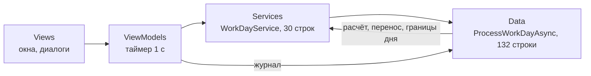

# Анализ WorkTimeRegister

Файл собирает разборы проекта по сессиям в порядке проведения. Каждая следующая сессия отвечает на предыдущие. Тексты сессий приведены без правок, изменён только уровень заголовков.

| Сессия | Кто | Дата | Что сделано |
| --- | --- | --- | --- |
| 1 | Claude (Opus 5.5) | 28 октября 2026 | Аудит чтением кода, без сборки и тестов |
| 2 | Codex | 28 октября 2026 | Сверка аудита с кодом, 69 тестов, 13 сценариев на временных базах |
| 3 | Codex | 28 октября 2026 | Реализация согласованных исправлений, восстановление после сбоя, пауза при сне, двуязычные правила |
| 4 | Claude (Opus 5.5) | 28 октября 2026 | Ревью коммита `f9d10ab` чтением кода, без сборки и тестов |

Сессии 1 и 2 проверяли версию 1.5.2, коммит `ef81e09`. Сессия 4 проверяла версию 1.6.0, коммит `f9d10ab`.

## Сессия 1: Claude, аудит кода

Версия 1.5.2, коммит `ef81e09`, 28 октября 2026. Аудит выполнил Claude Opus 5.5 чтением кода. Сборку и тесты аудитор не запускал.

### Итог

Серьёзных уязвимостей нет, ошибок, портящих базу, аудит не нашёл. Главный риск касается учёта: после падения программы и при опции «Продолжать рабочий день после полуночи» приложение засчитывает как работу часы, когда человек не работал. Архитектура выдержит рост данных, но рост функций даётся ей тяжело.

| Область | Оценка | Коротко |
| --- | --- | --- |
| Безопасность | Низкий риск | Сети нет, SQL с параметрами, импорт проверяется |
| Корректность учёта | 2 высоких риска | Простой и сон попадают в работу |
| Рост функций | Слабо | Логика дня в слое данных, 2 категории зашиты в схему |
| Процесс разработки | Слабо | Нет CI, анализаторов и единого стиля |

Находки: 4 с высоким риском, 5 со средним, 2 с низким.

| Показатель | Значение |
| --- | --- |
| Строк в `src` | 3400 |
| Строк тестов | 1739 |
| Тестов | 52 |
| Методов репозитория, которые рабочий код не вызывает | 10 из 13 |
| Коммитов в истории | 3 |

### Учёт времени

#### Т1. Падение программы засчитывает простой как работу (высокий)

При обычном выходе программа записывает закрытие дня, и время вне программы в итоги не входит. Если процесс падает, записи нет: день остаётся открытым, и период продолжается с момента до падения. Без опции «после полуночи» лишние часы копятся до 00:00, с опцией без ограничения.

Пример: работа с 09:00 до 18:00, программа закрыта с 14:00 до 15:00.

| Как закрыли программу в 14:00 | Работа за день |
| --- | --- |
| Обычный выход | 08:00:00 |
| Падение | 09:00:00 |

Где код может упасть:

- `ActionLogWindow.axaml.cs:35` и `:56` открывают файл экспорта и импорта вне `try`, внутри `async void`. Ошибка ввода-вывода (нет прав, файл занят) завершит процесс.
- `Uninstall.cmd` на Windows завершает процесс через `taskkill /F` (`packaging/windows/.../Program.cs:171`).

ТЗ, раздел 14, требует, чтобы ошибки не завершали приложение аварийно.

#### Т2. Опция «Продолжать рабочий день после полуночи» превращает сон ноутбука в работу (высокий)

При пробуждении цикл в `SqliteTimeEntryRepository.WorkDays.cs:19-33` проходит каждую пропущенную полночь: закрывает день и открывает следующий в том же режиме. Код не определяет сон или простой.

Пример: в пятницу человек работал с 09:00 до 18:00 и закрыл ноутбук, не завершив день. Открыл в понедельник в 09:00.

| Настройка | Пятница | Суббота | Воскресенье | Понедельник до 09:00 | Сверх факта |
| --- | --- | --- | --- | --- | --- |
| Без опции | 15:00:00 | 0 | 0 | 0 | +6 ч |
| С опцией | 15:00:00 | 24:00:00 | 24:00:00 | 09:00:00 | +63 ч |

Тест `WakeAfterSeveralDays` (`WorkDayServiceTests.cs:161`) проверяет число созданных дней, итоги промежуточных дней он не проверяет. ТЗ, раздел 12, задаёт это поведение («период продолжается до явного действия пользователя»), поэтому решать здесь автору продукта.

Цифры в обоих примерах аудитор посчитал по логике кода, прогоном их не подтверждал.

#### Т3. Второй экземпляр программы закрывает день у первого (средний)

В коде нет защиты от второго запуска. На Windows двойной запуск из меню «Пуск» даёт два процесса с двумя таймерами и двумя значками в трее, и выход из одного закрывает день у другого. Уникальные индексы и транзакции сохраняют данные целыми. На macOS Finder и Dock второй экземпляр обычно не запускают.

#### Т4. Сбой записи при выходе не даёт выйти (низкий)

`PrepareForExitAsync` (`MainWindowViewModel.cs:119-144`) при ошибке записи возвращает окно на экран. Пользователю остаётся принудительное завершение, а оно ведёт к Т1.

### Архитектура

Запросы выбирают один день по индексу, журнал фильтруется по индексу даты. Опрос базы раз в секунду для одного пользователя нагрузки не даёт. Сложности начнутся с новыми функциями.



Стрелка означает «использует». `Services` и `Data` ссылаются друг на друга. По ТЗ, раздел 16, репозиторий только читает и пишет.

#### А1. Логика рабочего дня живёт в слое данных и растёт одним switch (высокий)

`ProcessWorkDayAsync` (`SqliteTimeEntryRepository.WorkDays.cs:9-139`) разбирает 12 значений `WorkDayOperation`. Объект `WorkDayRequest` несёт поля для всех операций, каждая берёт часть. Новая функция добавит значение в enum, ветку в switch и необязательное поле. Правила дня нельзя проверить без SQLite.

#### А2. Две категории времени зашиты в код, схему и формат экспорта (высокий)

В коде 22 ветвления вида `kind == Work ? ... : Break` в 6 файлах, из них 10 в `TimeTransferPlanner`. Колонки `WorkAdjustmentSeconds`, `BreakAdjustmentSeconds`, `TotalWorkSeconds`, `TotalBreakSeconds` и поля JSON названы по категориям. Третья категория или учёт по проектам потребует миграции схемы и третьей версии формата экспорта.

#### А3. Миграции базы без номера версии (средний)

Код не использует `PRAGMA user_version`. Каждая миграция проверяет наличие таблиц и колонок и по ним решает, нужна ли она. Порядок миграций задают только вызовы в `InitializeAsync`. `MigrateWorkDaysAsync` занимает 156 строк.

#### А4. Журнал хранит готовый русский текст (средний)

Репозиторий собирает строку вида «Перенос 00:15:00: Работа → Перерыв» и пишет её в базу. Историю нельзя перевести, фильтр по типу события требует разбора текста, импорт ищет дубли по тексту (`SqliteTimeEntryRepository.cs:366-376`). Русские строки встречаются во всех слоях: 82 во `Views`, 40 во `ViewModels`, 34 в `Data`, 21 в `Services`.

#### А5. Копии кода начали расходиться (средний)

| Что повторяется | Копий |
| --- | --- |
| Чтение `TimeEntry` и `TimePause` из базы | 7 |
| Форматирование `ЧЧ:ММ:СС` | 4 |
| Параметры записи в журнал | 3 |
| `ModeName` | 3 |
| `Ensure*ColumnAsync` | 2 |

Две копии форматирования приводят часы к `int`, две к `long`.

#### А6. Старый API репозитория и незаконченный рефакторинг (низкий)

Рабочий код вызывает 3 из 13 методов `ITimeEntryRepository`, остальные 10 вызывают только тесты. `MainWindowViewModelTests` готовят данные через `StartAsync` и `StopActiveAsync`, этим путём пользователь не проходит. `MainWindowViewModel` принимает `TimeSummaryCalculator` и не использует его, а репозиторий создаёт свой экземпляр.

#### А7. Нормы разработки не закреплены инструментами (средний)

В репозитории нет CI, `.editorconfig`, анализаторов и `TreatWarningsAsErrors`. Одно поле названо с подчёркиванием, 43 без него. Правила записаны в AGENTS.md, часть скопирована из шаблона (docker-compose, endpoints, frontend).

### Безопасность

| Область | Оценка | Что в коде |
| --- | --- | --- |
| SQL-инъекции | Нет | Значения идут параметрами. Интерполяция в `WorkDays.cs:260` берёт фильтр из двух констант |
| Импорт JSON | Защищён | Формат, версия, до 100 000 записей, действие до 1000 символов, режимы и длительности. Импорт меняет только журнал |
| Размер файла импорта | Низкий риск | Лимит записей проверяется после полного разбора, размер файла не ограничен |
| Секреты в истории | Нет | В 3 коммитах паролей, токенов и ключей нет |
| Хранение базы | Обычно | Без шифрования в профиле пользователя |
| Подпись сборок | Риск при раздаче | macOS: ad-hoc подпись без нотаризации. Windows: без подписи |
| Инсталлятор Windows | Нормально | Ставит программу для текущего пользователя, распаковывает архив из exe, ничего не скачивает |
| Зависимости | Не проверялись | Avalonia 11.3.20, Microsoft.Data.Sqlite 10.0.1, SQLitePCLRaw 2.1.13, SkiaSharp 2.88.9 |

### Мелкие дефекты

- Экспорт обнуляет выбранный файл до записи (`ActionLogWindow.axaml.cs:36-38`). Если запись упадёт, старое содержимое пропадёт.
- `App.axaml.cs:30` инициализирует базу без обработки ошибок. С повреждённой базой программа не запустится и ничего не сообщит.
- Код без вызовов: `ToggleBreakCommand`, `EndBreakCommand`, `BreakActionText`, `TimeTransferPlanner.CreatePlan`.
- Таймер раз в секунду открывает соединение и транзакцию и делает 6 запросов.
- ТЗ версии 1.0 от 29 августа 2026 описывает модель без рабочих дней, паузы, настроек и Windows.

### Что сделано хорошо

- Каждая операция идёт в транзакции, тест проверяет откат при сбое записи в журнал.
- Уникальные индексы базы держат правила «один активный период», «одна пауза», «один открытый день».
- Время хранится в UTC, переход на летнее и зимнее время обработан и покрыт тестами.
- Перед переходом старой базы на рабочие дни код создаёт резервную копию.
- Тесты подменяют время через `TimeProvider` и проверяют полночь и сон без ожидания.

### Вопросы к автору

1. Должен ли сон ноутбука с открытым днём считаться работой? Варианты: ограничить длительность, спрашивать при пробуждении, закрывать день при уходе в сон.
2. Планируются ли третья категория времени или учёт по проектам? От ответа зависит срочность А2.
3. Будут ли сборки раздаваться кому-то кроме автора? Тогда понадобятся сертификаты подписи для macOS и Windows.
4. Можно ли удалить 10 старых методов репозитория и перевести тесты на рабочий путь?
5. Обновлять ТЗ или считать README основным описанием?

### Метод

Аудитор прочитал весь `src`, инсталлятор, скрипты сборки, 52 теста, README, AGENTS.md и ТЗ. Счётные цифры получены поиском по коду на коммите `ef81e09`. Сборку и тесты аудитор не запускал, выводы Т1 и Т2 сделаны по логике кода. Базы уязвимостей зависимостей аудитор не сверял.

## Сессия 2: Codex, разбор аудита

Дата: 28 октября 2026 года.  
Версия проекта: 1.5.2.  
Проверенный коммит: `ef81e09`.

### Общий вывод

**Аудит полезный, основные риски учёта времени подтверждаются. Но архитектурные замечания я бы оценил спокойнее: проекту нужны точечные исправления и постепенное упорядочивание, а не переписывание.**

Я сверил замечания с кодом, запустил существующие тесты и дополнительно смоделировал проблемные ситуации на временных базах. Рабочую базу пользователя не использовал.

### Что стоит исправить в первую очередь

| Замечание | Моя оценка и предложение |
| --- | --- |
| Время после аварийного завершения попадает в учёт | Подтверждено. В примере из аудита штатный выход даёт 8 часов, аварийный — 9. Это относится и к работе, и к перерыву. Нужен отдельный механизм восстановления после сбоя. |
| Сон при незавершённом дне засчитывается в активный режим | Подтверждено моделированием. С продолжением через полночь получаются указанные в аудите дополнительные 63 часа. Однако это следствие ранее согласованного непрерывного учёта. Изменение поведения нужно отдельно согласовать. |
| Ошибки открытия файлов не обработаны | Подтверждено в `src/WorkTimeRegister/Views/ActionLogWindow.axaml.cs`, строка 23 и далее. Обработку ошибок нужно распространить на выбор файла, открытие, чтение, запись и закрытие потока. |
| Экспорт заранее очищает существующий файл | Я бы повысил приоритет этого замечания: можно потерять предыдущий экспорт. Нужно сначала проверить данные и записать результат во временный файл, затем заменить выбранный файл после успешного сохранения. |
| Второй экземпляр влияет на первый | Подтверждено на двух экземплярах сервиса с общей БД: выход второго закрывает общий день. Предлагаю разрешать один экземпляр приложения; повторный запуск должен открывать его окно. |
| Ошибка открытия базы при запуске | Подтверждено отсутствие обработки в `src/WorkTimeRegister/App.axaml.cs`, строка 30. Нужны понятное сообщение, путь к базе и варианты дальнейших действий. Повреждённую базу нельзя автоматически заменять пустой. |

### Восстановление после аварийного завершения

Для аварийного завершения нужно сохранять отметку последней подтверждённой активности приложения. После сбоя показывать, например:

> Приложение завершилось некорректно. Последняя подтверждённая активность — 14:00. Сейчас — 15:00. Учитывать этот интервал?

Варианты: **не учитывать / учитывать / скорректировать**. Решение записывать в журнал. Такая отметка уменьшает неопределённость, но не позволяет точно установить момент аварии.

Есть дополнительная тонкость: сейчас настройка восстановления после выхода применяется к **штатному выходу**. После сбоя день остаётся открытым и продолжает учитываться даже при отключённом восстановлении.

### Учёт времени сна

Для сна рекомендую отдельную настройку:

- **Учитывать время сна** — сохраняет нынешнее поведение.
- **Приостанавливать учёт во время сна** — автоматически включает паузу.
- После пробуждения — отдельный выбор: автоматически продолжать или оставаться на паузе.

Для личного учёта я предпочёл бы **паузу при сне и ручное продолжение после пробуждения**. Это уменьшает случайные начисления. Опцию продолжения через полночь при этом сохраняем: она решает другую задачу.

### С чем в аудите я согласен частично

- **Две категории времени — не высокий риск для текущей задачи.** Пока нужны только работа и перерыв, универсальная система категорий добавит сложность. Возвращаться к ней стоит при появлении проектов или третьей категории.
- **Логику рабочего дня действительно стоит постепенно выносить из репозитория.** Но транзакции должны сохраниться: изменение периода, итогов и журнала обязано оставаться одной операцией.
- **Отказ выходить при ошибке сохранения — защитное поведение.** Улучшить нужно интерфейс: предложить повторить сохранение, остаться в приложении или принудительно выйти с объяснением последствий.
- **52 теста в аудите и 69 в отчёте запуска не противоречат друг другу.** В проекте 52 тестовых метода, параметризованные проверки дают 69 случаев.
- Формулировка **«серьёзных уязвимостей нет» слишком категорична** для проверки чтением кода без анализа уязвимостей зависимостей. Оснований считать приложение небезопасным аудит не показал, но полной проверки безопасности тоже не было.

### Предлагаемый порядок работ

1. **Надёжность без изменения правил учёта:** обработка ошибок файлов и базы, безопасный экспорт, ограничение размера импорта, защита от второго запуска, корректное завершение перед удалением приложения в Windows.
2. **Восстановление после сбоя и обработка сна:** после согласования поведения, с проверками работы, перерыва, паузы и перехода через полночь.
3. **Поддерживаемость:** автоматические проверки в GitHub, версии миграций базы, перевод тестов на реальные пользовательские операции, постепенное устранение дублирования. Публичные методы пока не удалять.
4. **Документация и резервирование:** обновить ТЗ под нынешние функции. Отдельно описать, что JSON журнала **не является полной резервной копией базы**; для полного восстановления нужен бэкап SQLite.

### Выполненные проверки

Проверки выполнены при подготовке разбора аудита.

```sh
dotnet test WorkTimeRegister.slnx --no-restore
```

Результат: **69 пройдено, 0 ошибок**; сборка в рамках тестов успешна.

```sh
dotnet run --project /private/tmp/worktimeregister-audit-probe/AuditProbe.csproj -p:NuGetAudit=false --no-launch-profile
```

Результат: **13 дополнительных сценариев подтвердили описанное поведение**. Проверка моделировала аварийный перезапуск, промежуток сна и взаимодействие двух экземпляров сервиса с общей временной базой. Реальный перевод компьютера в сон и запуск двух окон приложения в эту проверку не входили.

```sh
git diff --exit-code
```

Результат: изменений файлов проекта при анализе не было.

### Рекомендация

Начать рекомендую с первого этапа. Он устранит конкретные дефекты, сохранив согласованную логику учёта.

Исправления по результатам аудита пока не внесены. Новый установщик и коммит не создавались.

## Сессия 3: Codex, реализация согласованных исправлений

Дата: 28 октября 2026 года.

Основа: коммит `9d0932a` с предыдущими сессиями анализа.

Подготовленная версия приложения: **1.6.0**, сборка macOS **19**.
Статус на момент подготовки: локальная реализация и проверки; коммит и отправка в GitHub ожидали подтверждения пользователя.

### Согласованные требования

Пользователь поручил применить первый этап исправлений и отдельно подтвердил расширение:
«Также восстановление после сбоя и пауза при сне».

Дополнительно согласовано вести анализ и рекомендации в этом файле и подготовить полный
английский перевод правил. Точное имя существующего файла — `ANALYSIS.md`; переименование
в `Analysis.md` не выполнялось. Сессии 1 и 2 сохранены без изменения их текста.

### Что реализовано

| Область | Результат |
| --- | --- |
| Экспорт JSON | Запись во временный файл в папке назначения, сброс данных на диск, замена выбранного файла только после успеха. Ошибка или отказ операции сохраняют предыдущий файл. |
| Ошибки файлов | Выбор, открытие, чтение, запись и освобождение файлов включены в обработку ошибок. Импорт и экспорт защищены от повторного одновременного нажатия. |
| Импорт JSON | Ограничение 128 МиБ проверяется и до чтения, если размер известен, и во время чтения потока. Пустая запись в массиве даёт понятную ошибку. Форматы JSON 1 и 2 сохранены. |
| Единственный экземпляр | Блокировка отдельного служебного файла и локальное уведомление существующего процесса. Повторный запуск открывает его окно и не создаёт второй таймер. |
| Ошибка запуска | Окно с путём к базе, причиной, повтором, открытием папки и выходом. Существующая база не заменяется пустой. |
| Ошибка выхода | Можно повторить сохранение, остаться в приложении или явно выйти без сохранения. |
| Удаление в Windows | Удалён `taskkill /F`. Команда `--shutdown` запрашивает штатное завершение; при отказе или работающем процессе удаление отменяется. База не удаляется. |
| Миграция | Перед обновлением непустой базы создаётся `worktime.db.before-reliability-<дата>-<идентификатор>.bak`. Добавлена версия схемы через `PRAGMA user_version=2`. База будущей версии отклоняется до изменения данных. |
| Восстановление | Контрольные отметки активности, обнаружение незавершённой сессии и диалог выбора неизвестного интервала. |
| Сон | Подписка на системные уведомления macOS и Windows; автоматическая пауза, настройка продолжения после пробуждения, сохранение ручной паузы. |
| Правила | В `AGENTS.md` добавлены правила обсуждения в `ANALYSIS.md`. Полный перевод всех правил сохранён в `AGENTS.en.md`. |

### Правила восстановления после сбоя

1. Контрольная отметка сохраняется при операциях пользователя и при обновлении таймера
   с интервалом не более 15 секунд. Она подтверждает работу программы, а не присутствие человека.
2. После сбоя итог на экране фиксируется на последней отметке, а неизвестный интервал
   от неё до запуска ожидает решения пользователя.
3. Доступны варианты: не учитывать, учесть целиком или указать длительность вручную.
   При ручном вводе учитывается время **с начала неизвестного интервала**. Для длительности
   больше суток используется запись `Д.ЧЧ:ММ:СС`.
4. Ожидание ответа в диалоге исключается. После решения открытый день остаётся на паузе;
   продолжение выполняется явно. Ранее установленная пауза сохраняется.
5. Переходы через полночь применяются после решения. Учтённые и исключённые интервалы
   распределяются по календарным дням, а не целиком записываются в день запуска.
6. При выключенном продолжении через полночь прежний день закрывается на своей границе;
   последующие дни автоматически не открываются. В диалоге явно показан максимум до конца
   этого дня; ручной ввод сверх предела отклоняется, кнопка полного учёта меняет подпись.
7. Выход без восстановления сохраняет необходимость выбора при следующем запуске.
8. Изменение периодов, пауз, служебного состояния и запись решения в журнал выполняются
   в одной транзакции. Ошибка записи журнала откатывает восстановление.

### Правила сна

- `PauseDuringSleep=true` по умолчанию: сон не включается ни в работу, ни в перерыв.
- `ResumeAfterSleep=false` по умолчанию: после пробуждения нужно нажать «Продолжить».
- Автоматическое продолжение снимает только паузу, созданную перед сном; ручная пауза сохраняется.
- При выключенном `PauseDuringSleep` сохранён прежний непрерывный учёт.
- Завершённый день не открывается при пробуждении.
- При продолжении через полночь пауза переносится на следующие сутки, сохраняя нулевые
  итоги за время сна. При выключенном продолжении прежний день закрывается в полночь.
- Если пришло уведомление о пробуждении без предварительного уведомления о сне и после
  последней отметки прошло больше минуты, интервал исключается с последней отметки.
  Это запасной механизм; точный момент сна при пропущенном уведомлении неизвестен.

Для macOS используются уведомления центра `NSWorkspace`, для Windows — `WM_POWERBROADCAST`
через существующее окно Avalonia. Новые зависимости и новый UI-фреймворк не добавлялись.
Основания: [Apple: willSleepNotification](https://developer.apple.com/documentation/appkit/nsworkspace/willsleepnotification),
[Apple: didWakeNotification](https://developer.apple.com/documentation/appkit/nsworkspace/didwakenotification),
[Microsoft: WM_POWERBROADCAST](https://learn.microsoft.com/en-us/windows/win32/power/wm-powerbroadcast).

### Проверки

```sh
dotnet test WorkTimeRegister.slnx --no-restore -m:1 -nodeReuse:false
```

Результат: **103 тестовых случая пройдено, 0 ошибок**. По сравнению с исходной версией
добавлено 34 проверяемых сочетания. Один существующий тест переключения режимов переведён
на реальные команды одной сессии вместо создания нескольких экземпляров ViewModel без выхода.
Публичные методы репозитория не удалялись.

Тесты миграции со старой схемы теперь явно подтверждают неизвестный интервал перед проверкой
итогов: старый незавершённый период больше не продолжается молча. Дополнительно проверено,
что ручная корректировка времени старого открытого дня учитывается при выборе контрольной
отметки и не приводит к отрицательному замороженному итогу.

Покрыты работа, перерыв, ручная пауза, завершённые периоды, варианты восстановления,
ожидание ответа, несколько суток, отсутствие продолжения через полночь, откат транзакции,
повторный сбой до принятия решения, миграция и сохранение прежнего экспорта.

```sh
dotnet run --project /private/tmp/worktimeregister-native-qa/NativeQa.csproj -p:NuGetAudit=false --no-launch-profile
```

Изолированная проверка на временных данных:

- реальный второй процесс не получил блокировку и успешно передал команду активации первому;
- нативная подписка macOS получила отправленные тестом уведомления `NSWorkspace` о сне и пробуждении;
- окна настроек, восстановления и ошибки базы отрисованы, проверены изображения и положение кнопок;
- размеры содержимого: настройки `680×577`, восстановление `660×492`, ошибка базы `640×233`.

Реальный перевод компьютера в сон, пробуждение аппаратным событием и запуск в Windows
не выполнялись. Логика этих переходов проверена автоматическими сценариями; Windows требует
отдельной проверки на целевой системе.

```sh
dotnet run --project /private/tmp/worktimeregister-lifecycle-qa/LifecycleQa.csproj -p:NuGetAudit=false --no-launch-profile -- startup-error
dotnet run --project /private/tmp/worktimeregister-lifecycle-qa/LifecycleQa.csproj -p:NuGetAudit=false --no-launch-profile -- recovery
```

Код жизненного цикла `App.axaml.cs` дополнительно проверен в отдельном стенде с временной
базой и тестовым путём данных:

- повреждённый файл не перезаписывается;
- повтор после исправления файла загружает главное окно;
- диалог аварийного восстановления применяется в ходе полного запуска приложения;
- команда из другого процесса показывает скрытое главное окно;
- команда штатного выхода завершает активный период и возвращает успешный результат клиенту.

Проверка выявила удержание повреждённого файла пулом SQLite. При ошибке запуска добавлено
освобождение пула соединений; повторная проверка прошла успешно.

### Сборки

```sh
./scripts/build-macos-installer.sh osx-arm64
```

Результат: созданы `artifacts/WorkTimeRegister-1.6.0-osx-arm64.pkg` и
`artifacts/WorkTimeRegister-1.6.0-osx-arm64.dmg`. Приложение извлечено из пакета во временную
папку; `codesign --verify --deep --strict` прошёл успешно, версия в `Info.plist` — `1.6.0`.
Сохраняется локальная ad-hoc подпись; нотариальное заверение не выполнялось.
Команда упаковки выводила сообщения `write: Permission denied` и предупреждение об устаревшем
синтаксисе `hdiutil create`, но завершилась с кодом 0. Независимая проверка извлечённого
приложения и контрольной суммы окончательного DMG прошла успешно.

```sh
./scripts/build-windows-installer.sh win-x64
```

Результат: создан `artifacts/WorkTimeRegister-1.6.0-win-x64-Setup.exe`. Сборка приложения
и самодостаточного установщика завершилась успешно. Запуск установщика в Windows не выполнялся.

### Что остаётся отдельным этапом

- Перенос правил дня из слоя данных и удаление устаревшего API — без широкого рефакторинга в этой версии.
- Универсальные категории и учёт проектов — только при появлении соответствующих требований.
- Типизированные события журнала, автоматические проверки GitHub и единые анализаторы.
- Полное обновление старого DOCX-ТЗ. Текущее поведение описано в обновлённом `README.md`.
- Сертификаты подписи и нотариальное заверение для распространения сборок.

JSON журнала по-прежнему не является полной резервной копией SQLite. Существующая рабочая
база пользователя во время разработки и тестов не открывалась для изменения. Установщики
не запускались на установку.

### Согласование публикации

Предлагаемое сообщение коммита:

```text
feat: add crash recovery, sleep pause and safer data handling
```

В коммит входят перечисленные ниже файлы. Установщики, временные проверки и базы данных
не входят в Git. Перед созданием коммита и отправкой требуется подтверждение пользователя.
Подтверждение получено 28 октября 2026 года сообщением «отправляй».

`git diff --check` выполнен успешно. Русская и английская версии правил содержат одинаковые
45 пунктов верхнего уровня и 10 разделов; перевод выполнен по всему файлу, включая новые правила.

### Изменённые файлы

- [.gitignore](.gitignore)
- [AGENTS.en.md](AGENTS.en.md)
- [AGENTS.md](AGENTS.md)
- [ANALYSIS.md](ANALYSIS.md)
- [README.md](README.md)
- [packaging/macos/Info.plist](packaging/macos/Info.plist)
- [packaging/windows/WorkTimeRegister.Installer/Program.cs](packaging/windows/WorkTimeRegister.Installer/Program.cs)
- [scripts/build-macos-installer.sh](scripts/build-macos-installer.sh)
- [src/WorkTimeRegister/App.axaml.cs](src/WorkTimeRegister/App.axaml.cs)
- [src/WorkTimeRegister/Data/SqliteTimeEntryRepository.Runtime.cs](src/WorkTimeRegister/Data/SqliteTimeEntryRepository.Runtime.cs)
- [src/WorkTimeRegister/Data/SqliteTimeEntryRepository.WorkDays.cs](src/WorkTimeRegister/Data/SqliteTimeEntryRepository.WorkDays.cs)
- [src/WorkTimeRegister/Data/SqliteTimeEntryRepository.cs](src/WorkTimeRegister/Data/SqliteTimeEntryRepository.cs)
- [src/WorkTimeRegister/Models/WorkDay.cs](src/WorkTimeRegister/Models/WorkDay.cs)
- [src/WorkTimeRegister/Program.cs](src/WorkTimeRegister/Program.cs)
- [src/WorkTimeRegister/Services/ActionLogJsonService.cs](src/WorkTimeRegister/Services/ActionLogJsonService.cs)
- [src/WorkTimeRegister/Services/AtomicFileService.cs](src/WorkTimeRegister/Services/AtomicFileService.cs)
- [src/WorkTimeRegister/Services/ComputerSleepService.cs](src/WorkTimeRegister/Services/ComputerSleepService.cs)
- [src/WorkTimeRegister/Services/SingleInstanceService.cs](src/WorkTimeRegister/Services/SingleInstanceService.cs)
- [src/WorkTimeRegister/Services/SizeLimitedReadStream.cs](src/WorkTimeRegister/Services/SizeLimitedReadStream.cs)
- [src/WorkTimeRegister/Services/WorkDayService.cs](src/WorkTimeRegister/Services/WorkDayService.cs)
- [src/WorkTimeRegister/ViewModels/LogWindowViewModel.cs](src/WorkTimeRegister/ViewModels/LogWindowViewModel.cs)
- [src/WorkTimeRegister/ViewModels/MainWindowViewModel.cs](src/WorkTimeRegister/ViewModels/MainWindowViewModel.cs)
- [src/WorkTimeRegister/Views/ActionLogWindow.axaml](src/WorkTimeRegister/Views/ActionLogWindow.axaml)
- [src/WorkTimeRegister/Views/ActionLogWindow.axaml.cs](src/WorkTimeRegister/Views/ActionLogWindow.axaml.cs)
- [src/WorkTimeRegister/Views/ExitErrorDialog.cs](src/WorkTimeRegister/Views/ExitErrorDialog.cs)
- [src/WorkTimeRegister/Views/RecoveryDialog.cs](src/WorkTimeRegister/Views/RecoveryDialog.cs)
- [src/WorkTimeRegister/Views/SettingsDialog.axaml](src/WorkTimeRegister/Views/SettingsDialog.axaml)
- [src/WorkTimeRegister/Views/SettingsDialog.axaml.cs](src/WorkTimeRegister/Views/SettingsDialog.axaml.cs)
- [src/WorkTimeRegister/Views/StartupErrorWindow.cs](src/WorkTimeRegister/Views/StartupErrorWindow.cs)
- [tests/WorkTimeRegister.Tests/ActionLogJsonServiceTests.cs](tests/WorkTimeRegister.Tests/ActionLogJsonServiceTests.cs)
- [tests/WorkTimeRegister.Tests/AtomicFileServiceTests.cs](tests/WorkTimeRegister.Tests/AtomicFileServiceTests.cs)
- [tests/WorkTimeRegister.Tests/MainWindowViewModelTests.cs](tests/WorkTimeRegister.Tests/MainWindowViewModelTests.cs)
- [tests/WorkTimeRegister.Tests/RecoveryAndSleepTests.cs](tests/WorkTimeRegister.Tests/RecoveryAndSleepTests.cs)
- [tests/WorkTimeRegister.Tests/ReliabilityMigrationTests.cs](tests/WorkTimeRegister.Tests/ReliabilityMigrationTests.cs)
- [tests/WorkTimeRegister.Tests/SingleInstanceServiceTests.cs](tests/WorkTimeRegister.Tests/SingleInstanceServiceTests.cs)
- [tests/WorkTimeRegister.Tests/WorkDayMigrationTests.cs](tests/WorkTimeRegister.Tests/WorkDayMigrationTests.cs)

## Сессия 4: Claude, ревью коммита `f9d10ab`

Дата: 28 октября 2026 года.
Автор: Claude (Opus 5.5).
Проверенный коммит: `f9d10ab`, версия 1.6.0. Сравнение с `9d0932a`.

Ревью сделано чтением кода. Сборку, тесты и установщики автор ревью не запускал, поэтому 103 тестовых случая и проверки стендов из сессии 3 здесь не перепроверены.

### Итог

Коммит закрывает Т1, Т3 и Т4 из сессии 1, а также дефекты экспорта и запуска. Т2 закрыт на macOS: сессия 3 проверила подписку отправкой тестовых уведомлений, реальный сон не проверялся. На Windows закрытие Т2 зависит от того, присылает ли система окну сообщение о сне, и этого никто не проверял. Ревью нашло 2 замечания со средним риском и 4 с низким. Ошибок, портящих базу, ревью не нашло. Логика рабочего дня в слое данных выросла, и находка А1 стала тяжелее.

| Находка сессии 1 | Состояние в `f9d10ab` |
| --- | --- |
| Т1. Падение засчитывает простой | Закрыта: контрольная отметка не реже раза в 15 с и диалог выбора при запуске |
| Т2. Сон засчитывается в работу | macOS: закрыта. Windows: не проверено, см. Р1 |
| Т3. Второй экземпляр | Закрыта: блокировка файла, повторный запуск открывает окно первого процесса |
| Т4. Выход при ошибке записи | Закрыта: диалог «Повторить», «Остаться», «Выйти без сохранения» |
| Экспорт обнуляет файл | Закрыта: запись во временный файл, замена после успеха |
| Ошибка базы при запуске | Закрыта: окно с путём к базе и повтором, см. Р2 |
| `taskkill /F` при удалении | Закрыта: штатное завершение через `--shutdown`, см. Р3 и Р6 |
| А3. Миграции без версии | Частично: появился `PRAGMA user_version=2`, прежние миграции по-прежнему проверяют наличие колонок |
| А1. Логика дня в слое данных | Выросла: `ProcessWorkDayAsync` 132 → 207 строк, `WorkDayOperation` 12 → 15 значений |
| А2, А4, А5, А6, А7 | Без изменений, сессия 3 отложила их отдельным этапом |

| Показатель | `9d0932a` | `f9d10ab` |
| --- | --- | --- |
| Строк C# в `src` (только `.cs`) | 2998 | 3877 |
| Тестовых методов | 52 | 72 |

### Р1. Запасная проверка сна срабатывает только по сигналу пробуждения (средний)

Программа ставит паузу на сон двумя путями. Основной путь: система присылает сигнал «засыпаю», программа ставит паузу. Запасной путь: пришёл сигнал «проснулся» без сигнала «засыпаю», и с последней отметки прошло больше минуты, тогда программа ставит паузу с последней отметки (`SqliteTimeEntryRepository.WorkDays.cs:36-45`, условие `request.Operation == WorkDayOperation.Resume`).

Если система не прислала ни одного из двух сигналов, таймер после пробуждения продолжает период, и сон попадает в работу так же, как в 1.5.2. Обновление таймера раз в секунду (`Refresh`) разрыв в отметках не проверяет.

На Windows программа ждёт сообщение `WM_POWERBROADCAST` в главном окне (`ComputerSleepService.cs:24-31`). Приходит ли оно на ноутбуках с режимом Modern Standby, не проверяли ни сессия 3, ни это ревью. Можно рассмотреть проверку разрыва отметок и в обычном обновлении таймера, это не анализировалось.

### Р2. Любая ошибка после загрузки базы выглядит как ошибка базы, а «Повторить» вызывает ложное восстановление (средний)

`InitializeDesktopAsync` ловит все исключения одним блоком (`App.axaml.cs:108`) и показывает окно «Не удалось открыть базу данных» с советом проверить доступ к файлу и свободное место. В этот блок входят и шаги после загрузки данных (`App.axaml.cs:79-105`): создание окна, меню Dock, подписка на сон и диалог восстановления. `ComputerSleepService` бросает исключение, если macOS не дала подключить уведомления. Пользователь получит совет про файл базы при ошибке, которая к базе не относится.

Кнопка «Повторить» создаёт новую ViewModel, а с ней новый `WorkDayService` с новым идентификатором сессии (`WorkDayService.cs:8`). Первая попытка уже записала в базу `IsRunning=1` со своим идентификатором. Вторая попытка видит открытый день и чужую сессию и показывает «Программа завершилась некорректно» за секунды между попытками, хотя программа не падала. Условие: день открыт, и исключение возникло после строки `await viewModel.Initialization`.

Можно рассмотреть раздельные сообщения для ошибок базы и интерфейса и один идентификатор сессии на процесс, это не анализировалось.

### Р3. Сообщения `Uninstall.cmd` на Windows выводятся нечитаемыми символами (низкий)

Установщик записывает `Uninstall.cmd` в UTF-8 без BOM (`packaging/windows/WorkTimeRegister.Installer/Program.cs:190`), и две строки `echo` в нём на русском. `cmd.exe` читает пакетный файл в кодовой странице консоли, на русской Windows это CP866, и без `chcp 65001` выводит байты UTF-8 псевдографикой. Пользователь видит эти строки только при отмене удаления. На Windows ревью это не запускало.

### Р4. Диалог восстановления и журнал показывают время в техническом формате (низкий)

Программа хранит моменты с точностью до 100 нс (`SqliteTimeEntryRepository.cs:450`, формат `O`). Диалог выводит длительность через `TimeSpan.ToString()` (`RecoveryDialog.cs:35`, `:60`, `:62`), и пользователь увидит, например, `01:00:03.4567890`. Запись журнала о восстановлении (`SqliteTimeEntryRepository.WorkDays.cs:170`) содержит моменты в UTC в формате ISO, например `2026-10-28T11:00:00.1234567+00:00`, а остальной журнал показывает местное время. Тесты задают ровные часы и этот вывод не проверяют.

### Р5. Незаписанное пробуждение отключает паузу на следующий сон (низкий)

Отметку о начале сна (`SleepStartedAt`) снимают только обработка пробуждения и выход. Пока отметка стоит, программа пропускает сигнал «засыпаю» (`SqliteTimeEntryRepository.WorkDays.cs:178`). `HandlePowerEventAsync` выходит без записи, если программа не готова (`MainWindowViewModel.cs:141`), и показывает ошибку записи в строке состояния, не повторяя её. Если пробуждение не записалось, следующий сон пройдёт без паузы и попадёт в работу. Ручное «Продолжить» отметку не снимает.

### Р6. После обновления с 1.5.2 неизвестный интервал начинается с последнего события (низкий)

Миграция заполняет последнюю отметку самым поздним из начал периодов, пауз и переносов (`SqliteTimeEntryRepository.Runtime.cs:47-60`), потому что версия 1.5.2 отметок не писала. Если 1.5.2 упала с открытым днём, после обновления диалог покажет «Последняя подтверждённая активность» в момент начала периода, например 09:00, хотя человек работал до сбоя. Вариант «Не учитывать интервал» уберёт и эти часы. Случай разовый: он возникает только при первом запуске 1.6.0 после сбоя 1.5.2.

### Что сделано хорошо

- Решение по восстановлению, паузы и запись в журнал идут одной транзакцией, тест `FailedRecoveryLog_RollsBackPausesAndPreservesPendingDecision` проверяет откат.
- Сигнал сна несёт время события (`at`), поэтому запоздавшая обработка ставит паузу на момент засыпания.
- Повторный сигнал пробуждения данных не меняет: Windows может прислать два сигнала подряд (`ComputerSleepService.cs:29`).
- 12 тестовых методов в `RecoveryAndSleepTests` покрывают выходные, полночь без продолжения, ручную паузу, отказ записи журнала и повторный сбой до решения.
- Программа отказывается открывать базу будущей версии до изменения данных (`SqliteTimeEntryRepository.Runtime.cs:10-16`).

### Что ревью не проверяло

- Сборку, тесты и стенды сессии 3 автор ревью не запускал.
- Сон, удаление и вывод `Uninstall.cmd` на Windows не запускались.
- Зависимости по базам уязвимостей не сверялись.

### Вопросы

1. Нужна ли проверка разрыва отметок в обычном обновлении (Р1) до раздачи 1.6.0 под Windows?
2. Проверять ли сон и удаление на реальной Windows-машине до раздачи?
3. Исправлять ли Р2 и Р4 в 1.6.x или отложить вместе с А1?
